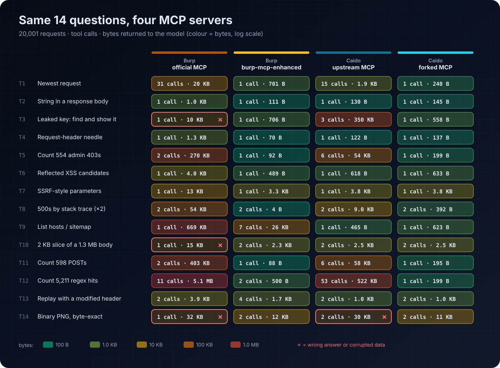
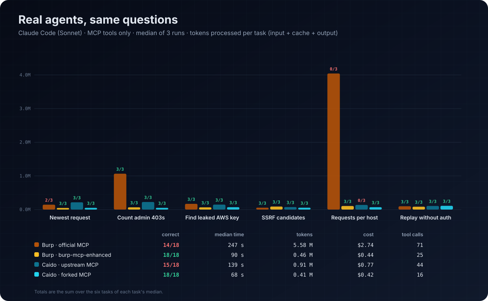
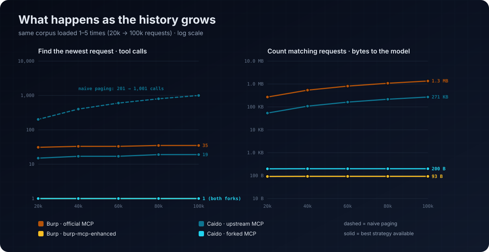
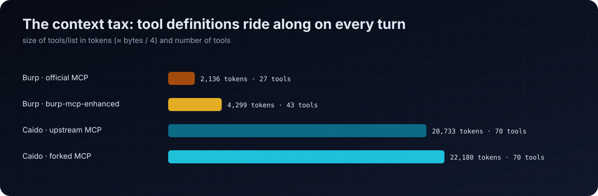
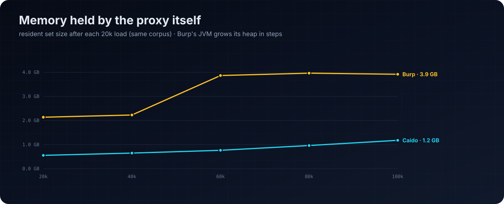

# proxy-mcp-bench

A benchmark for MCP servers that give an LLM agent access to a web proxy. It measures what an agent pays to answer common proxy-history questions: tool calls, bytes of tool output, wall time, tokens and correctness, on a history of 20,000 to 100,000 requests.

It compares four servers: the official or upstream MCP server for Burp Suite and for Caido, and an improved fork of each. Everything needed to rerun it is here: a deterministic lab target, a seeded traffic generator with ground truth, scripted task suites, an agent harness, the raw results and the chart generator.



## Servers

| Label | Server | Version measured |
|---|---|---|
| `burp-official` | [PortSwigger/mcp-server](https://github.com/PortSwigger/mcp-server), the Burp extension in the BApp Store | 1.3.0, built from the tag |
| `burp-fork` | burp-mcp-enhanced, a fork of PortSwigger/mcp-server (not public) | 1.3.0-enhanced.2; scale sweep on 1.3.0-enhanced.1 |
| `caido-official` | [c0tton-fluff/caido-mcp-server](https://github.com/c0tton-fluff/caido-mcp-server), the server Caido's [MCP tutorial](https://docs.caido.io/app/tutorials/mcp) points to | v4.4.0 release |
| `caido-fork` | [DavidCarliez/caido-mcp-server](https://github.com/DavidCarliez/caido-mcp-server), branch `integration/all` | `v4.4.0-12-gfc342df`; scale sweep on `v4.4.0-10-g10fbd6b` |

Proxies: Burp Suite Professional 2026.10.1 and Caido 0.59.0. The sweep builds differ from the final builds only in features the sweep tasks don't use.

## Results

Scripted tasks at 20,001 requests, summed over the 14 tasks in [docs/tasks.md](docs/tasks.md):

| Server | Correct | Tool calls | Output returned to the model |
|---|---:|---:|---:|
| burp-official | 11 / 14 | 58 | 6.6 MB |
| burp-fork | 14 / 14 | 27 | 48.1 KB |
| caido-official | 13 / 14 | 96 | 1.0 MB |
| caido-fork | 14 / 14 | 18 | 21.7 KB |

The caido-official total uses a row-ID bisection to find the newest request (15 calls). Paging from the oldest row instead takes 201 calls and 2 MB for that one task.

Real agents (Claude Code, Sonnet), six tasks with three runs each. Time, tokens and cost are the sum of each task's median:

| Server | Correct runs | Time | Tokens | Cost |
|---|---:|---:|---:|---:|
| burp-official | 14 / 18 | 247 s | 5.58 M | $2.74 |
| burp-fork | 18 / 18 | 90 s | 0.46 M | $0.44 |
| caido-official | 15 / 18 | 139 s | 0.91 M | $0.77 |
| caido-fork | 18 / 18 | 68 s | 0.41 M | $0.42 |



Without a server-side count or sort, cost grows with the history. At 100,005 requests, finding the newest request by paging takes 1,001 calls (10 MB) on caido-official, and counting 2,770 matches returns 1.35 MB on burp-official. Both forks stay at one call and under 1 KB.



Tool definitions are sent on every turn: about 2,100 tokens for burp-official (27 tools), 4,300 for burp-fork (43), 20,700 for caido-official (70) and 22,200 for caido-fork (70).





## How it works

1. `target/target_server.py` serves six virtual hosts with deterministic responses.
2. `corpus/gen_traffic.py` sends 20,000 seeded requests through the proxy, then a final marker request. Planted values make every answer checkable, and `--expected` prints the ground truth.
3. Part 1 runs 14 scripted tasks through each MCP server, using the best strategy that server's tools allow.
4. Part 2 loads the corpus five times (up to 100,005 requests) and repeats four tasks after each load, recording proxy memory.
5. Part 3 measures the size of each server's tool definitions.
6. Part 4 gives six plain-language tasks to headless Claude Code sessions that can only use the MCP server under test.

[docs/methodology.md](docs/methodology.md) covers isolation, what is measured, how the Burp approval dialogs and the replay task were handled, and the limits.

## Layout

```text
target/target_server.py      lab application, six vhosts on [::]:18080
corpus/gen_traffic.py        seeded corpus generator and ground truth (--expected)
corpus/expected.json         ground truth for the default corpus
caido/caido_suite.py         parts 1-3 against a Caido MCP server (stdio)
burp/mcp.py                  minimal MCP client for the Burp extension (SSE)
burp/measure_official.py     parts 1-2 against PortSwigger's extension
burp/measure_fork.py         parts 1-2 against burp-mcp-enhanced 1.3.0-enhanced.1
burp/measure_v3.py           part 1 against burp-mcp-enhanced 1.3.0-enhanced.2
burp/sweep.sh                part 2 driver: loads the corpus and measures after each load
burp/warm_approvals.py       triggers the extension's approval dialogs once per host
burp/call.py                 one tool call from the command line
agents/agent_run.py          part 4 harness (claude -p, MCP tools only)
agents/agent_tasks.json      agent prompts and answer checks
agents/configs/              example MCP configs for the harness
charts/make_figure_data.py   raw results -> results/figure-data.json, results/agents/final.jsonl
charts/charts.py             figures/*.svg from the figure data
results/                     raw results behind the figures
figures/                     rendered figures
docs/                        task definitions and methodology
```

## Requirements

- Python 3.11 or newer. The scripts use the standard library only.
- The `*.localhost` names must resolve to loopback. systemd-resolved does this; otherwise add `shop`, `api`, `admin`, `static`, `auth` and `graphql.localhost` to `/etc/hosts`.
- For Caido: Caido 0.59 and a `caido-mcp-server` binary for each build under test (Go 1.25+ to build the fork).
- For Burp: Burp Suite Professional with exactly one MCP extension loaded, serving SSE on `127.0.0.1:9876`.
- For part 4: the Claude Code CLI (`claude`) with API access. The published 72 runs cost about $15 at API rates.

## Running it

Start the target, and create the `runs/` directory the commands below write into (it is git-ignored):

```bash
python3 target/target_server.py 18080
mkdir -p runs
```

Create a fresh project in the proxy and load the corpus through its listener. Send nothing else first.

```bash
python3 corpus/gen_traffic.py --proxy 127.0.0.1:8080
```

**Caido, parts 1 to 3.** The suite needs a Caido access token in a file. `caido-mcp-server login` stores one under `~/.caido-mcp/tokens/`:

```bash
jq -r .accessToken ~/.caido-mcp/tokens/127.0.0.1_8080-*.json > caido.token

python3 caido/caido_suite.py --label caido-official --binary ./caido-mcp-server-v4.4.0 \
  --url http://127.0.0.1:8080 --token-file caido.token --part 1 --out runs/caido.json
python3 caido/caido_suite.py --label caido-fork --fork \
  --snippet-args '{"snippet": {"regex": "AKIA[A-Z0-9]{16}", "context": 20}}' \
  --binary ./caido-mcp-server-fork --url http://127.0.0.1:8080 --token-file caido.token \
  --part 1 --out runs/caido.json
```

Use `--part 3` for the tool definitions. For the sweep, run `--part 2 --k 1` for both servers, then load the corpus again and run `--part 2 --k 2`, and so on up to `--k 5`. `--fork` selects the strategies that need the fork's features (ordering, totals, snippets); without it the suite uses what upstream v4.4.0 offers.

**Burp, parts 1 and 2.** Load one extension, point a proxy listener at `127.0.0.1:18090`, load the corpus through it, and answer the approval dialogs once per host so later calls don't block:

```bash
for h in shop api admin static auth graphql; do python3 burp/warm_approvals.py $h.localhost; done
python3 burp/measure_official.py part1 1 runs/burp-official-k1.json   # or measure_fork.py
burp/sweep.sh official runs/                                           # or: burp/sweep.sh fork runs/
```

`burp/measure_v3.py runs/burp-fork-v3.json` runs part 1 on 1.3.0-enhanced.2, which has the regex search tool. [docs/methodology.md](docs/methodology.md) shows how to measure part 3 for Burp.

**Agents, part 4.** Copy an example config, adjust it, and run all six tasks:

```bash
cp agents/configs/caido.example.json caido.local.json
python3 agents/agent_run.py --label caido-fork --server caido \
  --mcp-config caido.local.json --out runs/agents.jsonl
```

`--server` is the server's key in the config (`caido` or `burp` in the examples). `--only A1,A2` runs a subset; `--model`, `--budget` and `--timeout` default to `sonnet`, $3 and 900 s. A5 resends a captured request, so it runs last and changes the history.

**Figures.**

```bash
python3 charts/make_figure_data.py   # results/ -> results/figure-data.json, results/agents/final.jsonl
python3 charts/charts.py             # -> figures/*.svg
```

From the committed results, these two commands regenerate the published figures byte for byte.

## Results files

| File | Contents |
|---|---|
| `results/caido.json` | Caido parts 1-3 for both servers, memory per sweep step |
| `results/burp.json` | Burp parts 1-3 for the official extension, the fork (1.3.0-enhanced.1) and the fork's part 1 and 3 re-run on 1.3.0-enhanced.2 (`burp-fork-v3`), with every recorded call |
| `results/agents/round1.jsonl` | first round of agent runs, all four servers |
| `results/agents/burp-fork-enhanced2.jsonl` | agent runs on burp-mcp-enhanced 1.3.0-enhanced.2 |
| `results/agents/caido-fork-final.jsonl` | agent runs on the final Caido fork build, A1-A4 and A6 |
| `results/agents/replay-snapshot.jsonl` | the replay task on both Caido servers, from one shared snapshot |
| `results/agents/replay-traced.jsonl` | traced replay runs from before the fork's last change |
| `results/agents/final.jsonl` | the 72 runs used in the figures (built by `make_figure_data.py`) |
| `results/figure-data.json` | normalised data for the charts |

## Limits

Everything runs on loopback, and the corpus is synthetic. One model with three runs per task shows variance but is not a statistical study. On Burp, the approval dialogs were answered before the agent runs. The Burp scripts are the ones used for the published runs; since then they have only been changed to use paths inside this repository, and they have not been re-run in this layout.

## License

MIT, see [LICENSE](LICENSE).
